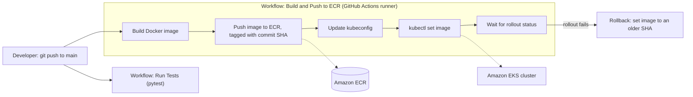

# AI-Ops Assistant

A backend API for IT Ops / Application Support workflows that automatically classifies ticket severity using an LLM and surfaces similar past tickets using RAG (Retrieval-Augmented Generation).

Built to practice and demonstrate: FastAPI, SQLAlchemy, LLM API integration, vector search, testing, containerization, and CI/CD — directly aligned with the real-world requirements of a Cloud/DevOps/Application Support Engineer role.

---

## Features

- **Full ticket CRUD** — create, read, update, delete
- **Automatic severity classification** — every new ticket is analyzed by the Claude API and assigned a severity level (`low` / `medium` / `high` / `critical`), no manual triage needed
- **Similar ticket suggestions (RAG)** — when a new ticket is created, the system automatically finds and returns related past tickets based on vector embeddings (Voyage AI) and semantic search (Chroma vector database)
- **Automated testing** — pytest suite covering CRUD and validation
- **Containerized** — runs consistently anywhere via Docker
- **CI/CD** — GitHub Actions automatically runs tests on every push

---

## Architecture

```
ai-ops-assistant/
├── main.py           # FastAPI app, endpoint definitions
├── models.py         # SQLAlchemy models (database tables)
├── schemas.py        # Pydantic schemas (request/response shapes)
├── rag.py            # Embedding + similarity search logic (Chroma, Voyage AI)
├── test_main.py       # Automated tests (pytest)
├── requirements.txt   # Dependency list
├── Dockerfile         # Container configuration
└── .github/workflows/test.yml   # CI pipeline
```

The codebase is split into three clear layers of responsibility: `models.py` (data) — `schemas.py` (API shape) — `main.py` (orchestration logic), keeping the code easy to extend and test independently.

### Why separate `TicketCreate` and `TicketResponse`?
Input and output aren't the same shape: clients don't send `id` or `created_at` when creating a ticket, but the response needs to include both. Splitting the schemas keeps the API contract explicit and avoids ambiguity.

---

## Tech Stack

| Component | Technology |
|---|---|
| Web framework | FastAPI |
| Database | SQLite + SQLAlchemy ORM |
| LLM classification | Claude API (Anthropic) |
| Vector embeddings | Voyage AI |
| Vector database | Chroma (persistent storage) |
| Testing | pytest |
| Containerization | Docker |
| CI/CD | GitHub Actions |

---

## Running Locally

```bash
# Clone the repo
git clone https://github.com/kimthu123/ai-ops-assistant.git
cd ai-ops-assistant

# Create a virtual environment
python3 -m venv venv
source venv/bin/activate

# Install dependencies
pip install -r requirements.txt

# Create a .env file with your API keys
echo "ANTHROPIC_API_KEY=your_key_here" >> .env
echo "VOYAGE_API_KEY=your_key_here" >> .env

# Run the server
uvicorn main:app --reload
```

Access the interactive API docs (Swagger UI) at `http://127.0.0.1:8000/docs`.

## Running with Docker

```bash
docker build -t ai-ops-assistant .
docker run -p 8000:8000 --env-file .env ai-ops-assistant
```

## Running Tests

## CI/CD Pipeline



**How it works**
- On every push to `main`, two workflows run in parallel: one runs `pytest`, the other builds and deploys.
- The image is tagged with the commit SHA, not `latest`, because Kubernetes only rolls out when the image reference changes, and a SHA tag lets me roll back to an exact commit.
- Deploys use a dedicated IAM user with least privilege: it can push to ECR and edit resources in the `default` namespace of the cluster, nothing else.
- `kubectl rollout status` fails the workflow if the new pods do not become ready, so a broken release shows up as a red run.
- Rollback: `kubectl set image` back to a previous commit SHA from ECR (or `kubectl rollout undo`).
- Known limitation: deploy does not wait for tests yet. See the Roadmap.

---

## API Endpoints

| Method | Endpoint | Description |
|---|---|---|
| POST | `/tickets` | Create a new ticket — auto-classifies severity and suggests similar tickets |
| GET | `/tickets` | List all tickets |
| GET | `/tickets/{id}` | Get a single ticket by id |
| PUT | `/tickets/{id}` | Update a ticket, re-classifying severity based on new content |
| DELETE | `/tickets/{id}` | Delete a ticket |
| GET | `/tickets/search/similar` | Search for similar tickets given any title/description |
| GET | `/analytics/severity` | Ticket counts grouped by severity level, with the overall total |
| GET | `/analytics/daily` | Ticket counts grouped by day (sorted ascending), with the overall total |

---

## Example Flow

Create a new ticket:

```bash
curl -X POST "http://127.0.0.1:8000/tickets" \
  -H "Content-Type: application/json" \
  -d '{"title": "Server crash", "description": "Production API returning 500 errors"}'
```

Response returned immediately:

```json
{
  "id": 13,
  "title": "Server crash",
  "description": "Production API returning 500 errors",
  "severity": "high",
  "created_at": "2026-09-02T13:10:13.834277",
  "similar_tickets": [
    {
      "ticket_id": 12,
      "content": "Server crash Production server down again",
      "similarity_distance": 0.97
    }
  ]
}
```

A single request returns the saved ticket, an AI-assessed severity level, and relevant historical context — no additional API calls required.

---

## Real Technical Problems Solved

- **Third-party API rate limiting (Voyage AI free tier)** — a 3 requests/minute cap caused failures under repeated testing; addressed by skipping the affected test in CI with a documented reason rather than leaving the pipeline flaky.
- **Vector data loss on server restart** — `chromadb.Client()` stores data in memory by default and loses everything on `--reload`. Switched to `PersistentClient` to persist data to disk.
- **Docker build cache optimization** — reordered Dockerfile instructions (copying `requirements.txt` before the rest of the code) to leverage layer caching and cut rebuild time when only application code changes.
- **Secret management in CI** — API keys are excluded from version control (`.gitignore`) and injected into the test environment via GitHub Secrets instead.

---

## Roadmap

- [ ] Deploy to Kubernetes (Pods, Services, ConfigMaps)
- [ ] Automate Docker image build + push in the CI/CD pipeline
- [ ] Migrate from SQLite to PostgreSQL for production use
